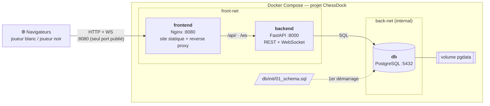

# ♟️ ChessDock

Jeu d'échecs en ligne pour **deux joueurs sur deux postes différents**, en temps réel.
L'application est découpée en **trois services Docker** orchestrés par Docker Compose :
un serveur web Nginx, une API Python (FastAPI) et une base PostgreSQL.


---

## Sommaire

- [Fonctionnalités](#fonctionnalités)
- [Lancer le projet](#lancer-le-projet)
- [Architecture](#architecture)
- [Les services](#les-services)
- [Configuration](#configuration)
- [Sécurité](#sécurité)
- [Mode développement](#mode-développement)
- [Base de données](#base-de-données)
- [API et protocole temps réel](#api-et-protocole-temps-réel)
- [Vérifier le bon fonctionnement](#vérifier-le-bon-fonctionnement)
- [Arborescence](#arborescence)
- [Dépannage](#dépannage)

---

## Fonctionnalités

- Choix d'un pseudo, **création d'une partie** (blancs) ou **rejoindre** avec un code à 6 caractères (noirs).
- Coups transmis **instantanément** à l'adversaire par WebSocket, sans recharger la page.
- **Règles complètes** appliquées par le serveur avec la bibliothèque [python-chess](https://python-chess.readthedocs.io/) :
  roque, prise en passant, promotion (choix de la pièce), échec, mat, pat, nulles (matériel
  insuffisant, triple répétition, 50 coups), abandon.
- Échiquier retourné côté noirs, coups possibles affichés, dernier coup et roi en échec surlignés,
  historique des coups.
- **Reprise automatique** : après un rechargement de page, une coupure réseau ou un redémarrage du
  backend, le joueur revient dans sa partie (jeton de reconnexion).
- **Toutes les parties et tous les coups sont enregistrés** dans PostgreSQL.

---

## Lancer le projet

**Prérequis** : Docker avec le plugin Compose (Docker Desktop sous Windows / macOS).

```bash
git clone https://github.com/ThomasHTB/Projet_Echecs_Docker.git
cd Projet_Echecs_Docker

cp .env.example .env              # PowerShell : Copy-Item .env.example .env
# éditer .env : remplacer POSTGRES_PASSWORD=change_me

docker compose up -d --build
docker compose ps                 # db doit passer "healthy" avant que le backend démarre
```

Ouvrir **http://localhost:8080**.

| Situation | Comment faire |
|---|---|
| Tester seul | Deux onglets du même navigateur (la partie est mémorisée **par onglet**) |
| Jouer à deux sur le réseau local | L'hôte lance la stack ; l'adversaire ouvre `http://<IP_de_l_hôte>:8080` (port 8080 autorisé dans le pare-feu) |
| Arrêter en gardant les parties | `docker compose down` |
| Tout réinitialiser | `docker compose down -v` (supprime le volume de la base) |

---

## Architecture



- **Un seul port publié sur l'hôte : 8080.** Le backend et la base n'ont aucun port ouvert.
- Le navigateur ne connaît qu'**une adresse** : Nginx sert la page et relaie `/api/` et `/ws`
  vers le backend. Pas de CORS à gérer et ça fonctionne tel quel depuis un autre poste.
- Le **backend est le seul service présent sur les deux réseaux** ; la base est sur un réseau
  `internal` : ni Nginx ni l'extérieur ne peuvent l'atteindre, et elle n'a pas accès à Internet.
- Ordre de démarrage garanti : `db` (healthcheck `pg_isready`) → `backend`
  (`depends_on: service_healthy`) → `frontend`.

Cheminement d'un coup :

```
Blanc clique e2 puis e4
  navigateur ──WS──► Nginx /ws ──► backend
                                    ├─ python-chess : coup légal ? bon joueur ? bon tour ?
                                    ├─ PostgreSQL : INSERT du coup + nouvelle position (une transaction)
                                    └─ envoie "game_state" aux deux joueurs
Noir voit le coup immédiatement
```

---

## Les services

| | `frontend` | `backend` | `db` |
|---|---|---|---|
| **Image** | build `./frontend` (base `nginxinc/nginx-unprivileged:1.27-alpine`) | build `./backend` (base `python:3.12-slim`, multi-stage) | `postgres:16-alpine` (officielle) |
| **Rôle** | Fichiers HTML/CSS/JS/SVG + reverse proxy | Logique de jeu, validation des coups, diffusion temps réel | Stockage des parties et des coups |
| **Utilisateur** | `nginx` (non-root) | `appuser` uid 10001 (non-root) | `postgres` |
| **Port** | 8080 → publié sur `${FRONTEND_PORT}` | 8000, interne | 5432, interne |
| **Réseaux** | front-net | front-net + back-net | back-net |
| **Healthcheck** | `wget` sur `/` (Dockerfile) | — | `pg_isready` (compose) |
| **Système de fichiers** | lecture seule + `tmpfs /tmp` | lecture seule + `tmpfs /tmp` | volume `pgdata` |
| **Limites** | 0,5 CPU · 128 Mo · 100 processus | 0,5 CPU · 256 Mo · 100 processus | 1 CPU · 512 Mo |

### frontend — Nginx

- `frontend/Dockerfile` copie uniquement les fichiers utiles au navigateur.
- `frontend/nginx.conf` :
  - `location /api/` et `location /ws` → `backend:8000` (en-têtes `Upgrade`/`Connection` pour le WebSocket,
    `proxy_read_timeout 3600s` pour garder la connexion pendant la partie) ;
  - `resolver 127.0.0.11` + adresse du backend en variable : Nginx re-résout le nom `backend` et
    retrouve donc le conteneur même s'il est recréé avec une nouvelle IP ;
  - en-têtes de sécurité (CSP, `X-Frame-Options`, `nosniff`, `Referrer-Policy`), version masquée.

### backend — FastAPI

- `backend/Dockerfile` en deux étapes : `builder` installe les dépendances (`pip --prefix=/install`),
  l'image finale ne récupère que ce dossier et les fichiers `.py`. `requirements.txt` est copié avant
  le code pour profiter du cache de build.
- Code :
  - `main.py` : routes REST, point d'entrée WebSocket, contrôle de l'origine, validation des messages ;
  - `games.py` : gestion des parties (création, rejoindre, reconnexion, coups, fin de partie) ;
  - `database.py` : pool de connexions `psycopg` asynchrone, requêtes SQL paramétrées.
- Les parties actives sont en mémoire **et** en base : si le conteneur redémarre, une partie est
  reconstruite depuis PostgreSQL (coups rejoués dans python-chess) au retour d'un joueur.
- Configuration uniquement par variables d'environnement (`DATABASE_URL`, `CORS_ORIGIN`).

### db — PostgreSQL

- Image officielle, configurée par variables d'environnement (pas de Dockerfile).
- `./db/init` monté **en lecture seule** sur `/docker-entrypoint-initdb.d` : le schéma est créé
  automatiquement au premier démarrage du volume.
- Données dans le volume nommé `pgdata`.

---

## Configuration

Le fichier `.env` (copié depuis `.env.example`, **non versionné**) est lu par Compose :

| Variable | Valeur par défaut | Rôle |
|---|---|---|
| `POSTGRES_DB` | `chess` | Nom de la base |
| `POSTGRES_USER` | `chess` | Utilisateur PostgreSQL |
| `POSTGRES_PASSWORD` | `change_me` | **À changer** |
| `DB_HOST` / `DB_PORT` | `db` / `5432` | Adresse de la base vue par le backend (nom du service) |
| `CORS_ORIGIN` | `http://localhost:8080` | Origines web autorisées en plus du site lui-même (liste séparée par des virgules) |
| `FRONTEND_PORT` | `8080` | Port publié sur la machine hôte |

Le backend reçoit une `DATABASE_URL` construite par Compose à partir de ces variables.

> ⚠️ Le mot de passe PostgreSQL est fixé à la **création** du volume. Si on le change ensuite dans
> `.env`, il faut recréer le volume (`docker compose down -v`).

---

## Sécurité

### Conteneurs

| Mesure | Mise en œuvre |
|---|---|
| Processus non-root | `USER appuser` (backend), image `nginx-unprivileged` (frontend) |
| Surface réseau minimale | Un seul port publié ; base sur réseau `internal` |
| Système de fichiers en lecture seule | `read_only: true` + `tmpfs: /tmp` (frontend, backend) |
| Pas d'élévation de privilèges | `security_opt: no-new-privileges:true` (tous) |
| Capabilities Linux retirées | `cap_drop: ALL` (tous) ; la base ne récupère que `CHOWN, DAC_OVERRIDE, FOWNER, SETGID, SETUID`, nécessaires au passage root → `postgres` de son entrypoint |
| Ressources bornées | `deploy.resources.limits` : CPU, mémoire, nombre de processus |
| Logs bornés | `json-file`, 3 fichiers de 10 Mo max |
| Secrets hors du code et des images | `.env` dans `.gitignore`, exclu par les `.dockerignore` |
| Builds reproductibles | Versions d'images et de dépendances Python figées |

Les options communes sont factorisées en haut de `docker-compose.yml` dans les blocs
`x-security` et `x-logging`, appliqués à chaque service via des ancres YAML.

### Application

- **Le serveur fait autorité** : chaque coup est revalidé par python-chess (pièce, joueur, tour).
  Modifier le JavaScript ne permet pas de tricher.
- **Jeton de reconnexion** aléatoire par joueur ; seule son empreinte SHA-256 est stockée,
  comparaison en temps constant.
- **Origine des WebSockets vérifiée** : connexion refusée si la page vient d'un autre site.
- **Entrées validées** : pseudo (1-20 caractères autorisés), format du code, taille des messages (2 Ko), JSON.
- **SQL paramétré** partout ; les empreintes de jetons ne sortent jamais par l'API.
- Les erreurs internes ne sont pas détaillées au client.

---

## Mode développement

```bash
docker compose -f docker-compose.yml -f docker-compose.dev.yml up --build
```

`docker-compose.dev.yml` surcharge la configuration de base :

| Service | Changement |
|---|---|
| backend | Code monté depuis `./backend` + `uvicorn --reload` (rechargement à chaque sauvegarde) ; API publiée sur `127.0.0.1:8000` → Swagger sur http://localhost:8000/docs |
| frontend | Fichiers du site montés : un rechargement de page suffit après modification |
| db | Publiée sur `127.0.0.1:5432` pour un client SQL (DBeaver, pgAdmin…) |
| back-net | `internal: false`, sinon la base ne peut pas publier de port |

Les ports de dev sont liés à `127.0.0.1` : accessibles uniquement depuis la machine du développeur.

---

## Base de données

Schéma créé par [`db/init/01_schema.sql`](db/init/01_schema.sql) :

```
games                                       moves
──────────────────────────────────          ─────────────────────────────
id                VARCHAR(8)  PK  ◄──────── game_id    FK (ON DELETE CASCADE)
white_name        VARCHAR(20)               ply        n° du demi-coup  ┐ UNIQUE
black_name        VARCHAR(20)               uci        ex. e2e4, e7e8q  ┘ (game_id, ply)
white_token_hash  CHAR(64)    (SHA-256)     san        ex. e4, Nf3, O-O
black_token_hash  CHAR(64)                  fen_after  position après le coup
fen               position actuelle         played_at
status            waiting | playing | finished
result            1-0 | 0-1 | 1/2-1/2
end_reason        checkmate, stalemate, resignation…
created_at, updated_at
```

Consulter les données :

```bash
docker compose exec db psql -U chess -d chess -c "SELECT id, white_name, black_name, status, result, end_reason FROM games ORDER BY updated_at DESC;"
docker compose exec db psql -U chess -d chess -c "SELECT ply, san FROM moves WHERE game_id = 'ABC123' ORDER BY ply;"
```

---

## API et protocole temps réel

### REST (via `http://localhost:8080/api/...`)

| Route | Réponse |
|---|---|
| `GET /api/health` | `{"backend":"ok","db":"ok","games_in_memory":N}` — `503` si la base est injoignable |
| `GET /api/games?limit=20` | Dernières parties (joueurs, statut, résultat, nombre de coups) |
| `GET /api/games/{code}` | Détail d'une partie et liste de ses coups |

### WebSocket `/ws` (messages JSON)

| Sens | `type` | Champs |
|---|---|---|
| → serveur | `create_game` | `name` |
| → serveur | `join_game` | `name`, `game_id` |
| → serveur | `rejoin_game` | `game_id`, `token` |
| → serveur | `move` | `from`, `to`, `promotion` (optionnel : `q` `r` `b` `n`) |
| → serveur | `resign`, `leave_game` | — |
| ← client | `game_created`, `game_joined` | `game_id`, `color`, `token` (à la première entrée dans la partie) |
| ← client | `game_state` | `fen`, `turn`, `status`, `result`, `end_reason`, `check`, `last_move`, `moves`, `legal_moves`, `players` |
| ← client | `error` | `message` |

`game_state` est envoyé aux deux joueurs après chaque événement (arrivée, coup, déconnexion,
abandon). Le client ne calcule rien : il affiche la position et propose les coups de `legal_moves`.
En cas de coupure, il se reconnecte avec un délai croissant (1 s → 15 s) puis envoie `rejoin_game`.

---

## Vérifier le bon fonctionnement

| Vérification | Commande | Résultat attendu |
|---|---|---|
| Services démarrés | `docker compose ps` | 3 services `running`, `db` et `frontend` `healthy` |
| Chaîne complète | `curl http://localhost:8080/api/health` | `{"backend":"ok","db":"ok",...}` |
| Backend non exposé | `curl http://localhost:8000/api/health` | Connexion refusée |
| Base sans Internet | `docker compose exec db wget -T 3 -qO- http://example.com` | Échec (réseau `internal`) |
| Non-root | `docker compose exec backend whoami` | `appuser` |
| Lecture seule | `docker compose exec backend touch /app/x` | `Read-only file system` |
| Limites appliquées | `docker stats --no-stream` | Colonne `LIMIT` à 128 / 256 / 512 Mo |
| Persistance | jouer, `docker compose down`, `docker compose up -d`, recharger la page | Partie retrouvée au même coup |
| Reprise après panne | en pleine partie : `docker compose restart backend` | Les clients se reconnectent, la partie continue |

---

## Arborescence

```
Projet_Echecs_Docker/
├── docker-compose.yml          # stack : 3 services, 2 réseaux, 1 volume
├── docker-compose.dev.yml      # surcharge développement
├── .env.example                # modèle de configuration
├── backend/
│   ├── Dockerfile              # multi-stage, non-root
│   ├── .dockerignore
│   ├── requirements.txt        # fastapi, uvicorn, psycopg, psycopg-pool, chess
│   ├── main.py                 # routes REST + WebSocket
│   ├── games.py                # logique des parties
│   └── database.py             # accès PostgreSQL
├── frontend/
│   ├── Dockerfile              # Nginx non-root + healthcheck
│   ├── .dockerignore
│   ├── nginx.conf              # statique + reverse proxy /api et /ws
│   ├── index.html · style.css
│   ├── script.js               # rendu de l'échiquier depuis le FEN
│   ├── websocket.js            # connexion + reconnexion automatique
│   ├── client.js               # lobby, coups, affichage de l'état
│   └── pieces/                 # pièces SVG
├── db/init/01_schema.sql       # schéma créé au premier démarrage
└── Repartition_Tache_Projet.md
```

---

## Dépannage

| Symptôme | Solution |
|---|---|
| `port is already allocated` | Changer `FRONTEND_PORT` dans `.env` |
| Backend en redémarrage, `password authentication failed` dans `docker compose logs backend` | Mot de passe modifié après création du volume → `docker compose down -v` puis `up` |
| Modification de `01_schema.sql` sans effet | Le script ne s'exécute que sur un volume vide → `docker compose down -v` |
| Page affichée mais « 🔴 Déconnecté » | `docker compose logs backend` |
| L'adversaire ne peut pas se connecter | Vérifier l'IP de l'hôte et ouvrir le port 8080 dans le pare-feu |
| Code modifié non pris en compte | `docker compose up -d --build`, ou utiliser le mode développement |

---
